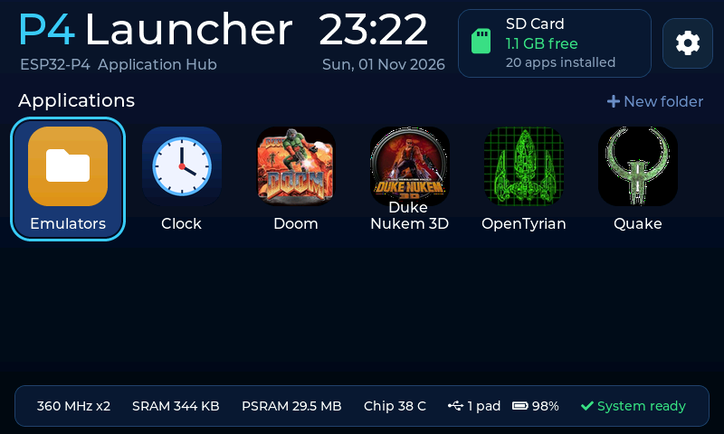
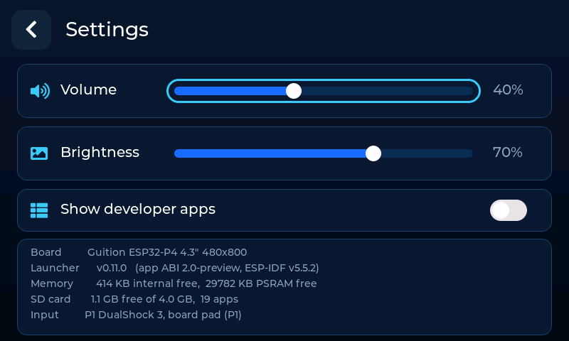
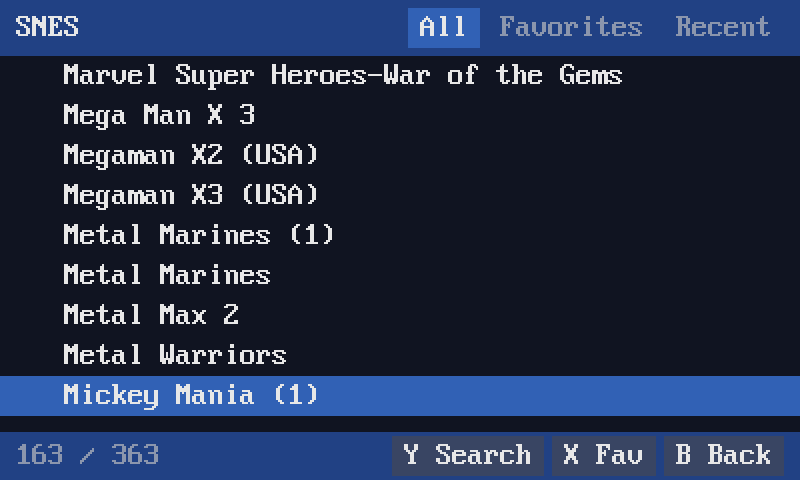
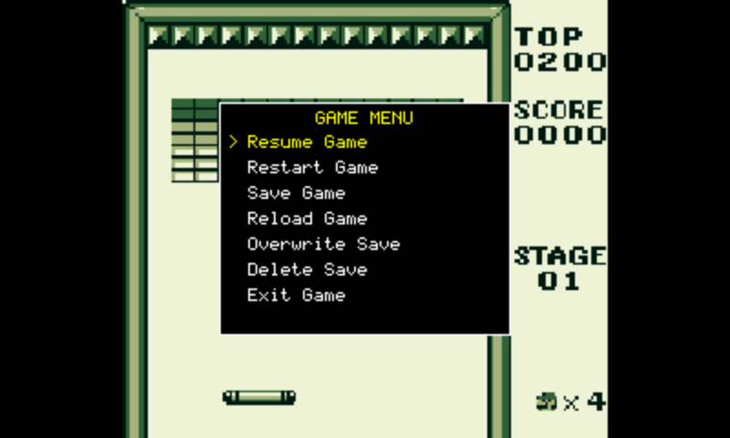
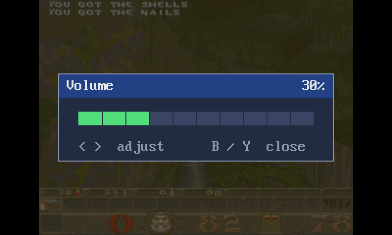
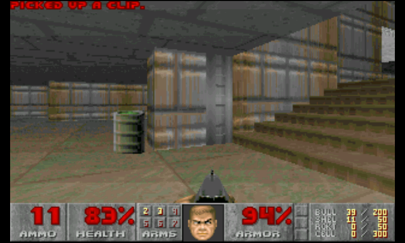
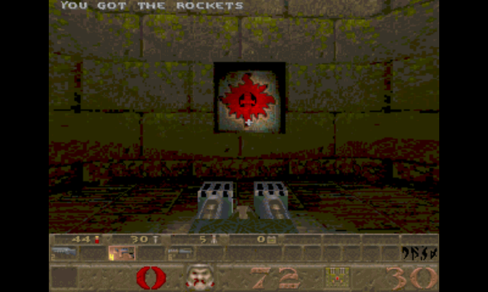
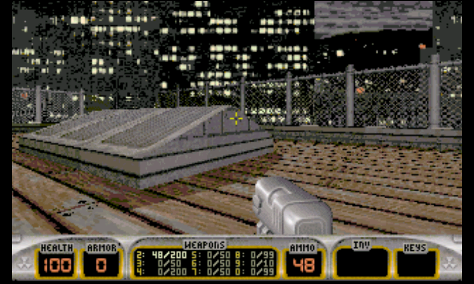

# ESP32-P4 Launcher

**Run applications from an SD card on an ESP32-P4, the way a PC runs a program from a disk.**

The launcher is a permanent firmware that stays in flash. Applications are `.papp` files on the SD card.
Pick one and it is loaded into PSRAM, relocated, linked to the launcher's services and started.
There's no reflashing, no reboot and no flash wear. When it exits, every resource it used is reclaimed.

19 applications run this way today, including NES through Neo Geo emulators plus Doom, Quake,
Duke Nukem 3D and OpenTyrian.



| Launcher version | App ABI | Toolchain | First board |
|---|---|---|---|
| 0.12.0 | 2.0-preview | ESP-IDF v5.5.2 | Guition ESP32-P4 4.3" (480×800) |

> **Status: active development.** The ABI is a preview and may still change. Everything below describes
> what exists in the code today; the plan for what comes next is in [docs/WORKPLAN.md](docs/WORKPLAN.md).

## Contents

- [Screens](#screens)
- [The PAPP concept](#the-papp-concept)
- [What's included](#whats-included)
- [Hardware](#hardware)
- [Getting started](#getting-started)
- [Preparing the SD card](#preparing-the-sd-card)
- [Controls](#controls)
- [Writing your own PAPP](#writing-your-own-papp)
- [The SDK](#the-sdk)
- [How loading works](#how-loading-works)
- [The `.papp` file format](#the-papp-file-format)
- [Developing without touching the board](#developing-without-touching-the-board)
- [Performance](#performance)
- [Porting to another board](#porting-to-another-board)
- [Repository layout](#repository-layout)
- [Known limitations](#known-limitations)
- [Credits and licensing](#credits-and-licensing)

## Screens

All of these are real screenshots, taken from the running board with `papp_dev.py shot`.

| | |
|---|---|
|  |  |
| **Settings:** volume, brightness, developer apps and system information | **Content browser:** All, Favorites and Recent tabs, with live search. Every emulator gets it from the launcher |
|  |  |
| **In-game menu** over the running game | **Volume overlay,** drawn by the launcher for any app |
|  |  |
| **Doom** | **Quake** |
|  | |
| **Duke Nukem 3D** | |

## The PAPP concept

PAPP stands for **PSRAM App**. The ESP32-P4 can execute code from PSRAM, so a program doesn't have to
live in flash. The launcher treats PSRAM the way a desktop OS treats RAM, and the SD card the way it
treats a disk.

The usual way to host many large programs on an ESP32 is one firmware image per program, flashed into
OTA slots, with a reboot to switch. PAPP replaces that:

| | One firmware per program (OTA) | PAPP |
|---|---|---|
| Where programs live | Flash partitions, fixed in advance | Files on the SD card |
| Adding a program | Reflash, possibly repartition | Copy a file |
| Switching programs | Reboot | Instant return to the launcher |
| Program size limit | Partition size | Free PSRAM |
| Same binary on another board | No, each board needs a build | Yes, that's the goal: only the launcher is ported |
| Cleanup after a program | The reboot does it | The launcher tracks and reclaims everything |

Think of a `.papp` as a **DLL with a `main()`**:

- **It is relocatable.** It has no fixed load address. The loader patches it to wherever memory is available.
- **It imports services by name.** The app declares that it needs, for example, display interface `DISP`.
  The loader checks the launcher provides it and fills in a table of function pointers.
- **It never touches hardware.** Apps include no ESP-IDF headers and know nothing about the board.
  Display, audio, input, files, threads and UI all go through the launcher's interfaces.
- **It can't leave the system broken.** Memory, files, threads and surfaces are tracked per app and
  reclaimed on exit. A hung app can be force-stopped, and a crash is reported with symbols instead of
  becoming a mysterious reboot.

```
┌──────────────────────────────────────────────────────────────┐
│  PAPP apps (.papp on SD)   emulators · games · your code     │
│  app code + SDK runtime (crt0, libc glue, interface stubs)   │
├───────────────  ABI: SYS MEM FS DISP AUDI INPT THRD UI  ─────┤
│  Launcher core (board-agnostic ESP-IDF app in flash)         │
│  loader · App Manager · compositor · audio mixer ·           │
│  input manager · content browser · DevLink · home screen     │
├───────────────  BSP contract: components/bsp/bsp.h  ─────────┤
│  Board package: panel, touch, codec, SD, buttons             │
├──────────────────────────────────────────────────────────────┤
│  ESP-IDF · FreeRTOS · PPA · USB host · I2S · MIPI-DSI        │
└──────────────────────────────────────────────────────────────┘
```

Two rules keep this portable: apps only see the ABI, and the launcher core only sees `bsp.h`.

## What's included

**Launcher**

- LVGL home screen with app icons, clock, SD status and settings
- Compositor: an app draws a surface of any size, and the launcher scales and rotates it with the PPA, tear-free
- Audio engine: up to 8 streams at any rate from 4 to 192 kHz, resampled and mixed
- Input manager: USB HID gamepads and keyboards for up to 4 players, board buttons and touch
- Content browser with folders, Favorites, Recent, search, and per-ROM Run/Resume/Restart/Delete save
- DevLink: a USB protocol to upload, run, log, screenshot, inject input and read crash reports

**Applications** (all built from this repository)

| App | Source | App | Source |
|---|---|---|---|
| NES | nofrendo | Genesis / Mega Drive | gwenesis |
| Game Boy, Game Boy Color | gnuboy | SNES | snes9x (no SuperFX) |
| Master System, Game Gear, ColecoVision | smsplus | Neo Geo | gngeo |
| PC Engine | huexpress | Atari Lynx | handy |
| Atari 2600 | stella | Atari 7800 | prosystem |
| Atari 800 / XL / 5200 | atari800 | ZX Spectrum | spectemu |
| Doom | prboom | Quake | WinQuake |
| Duke Nukem 3D | Chocolate Duke3D | OpenTyrian | OpenTyrian |

The test apps (`hello`, `gfx_demo`, `audio_test`, `input_test`, `thread_test`, `fast_bench`, `browse_test`,
`libc_test`) are hidden unless you turn on **Settings → Show developer apps**.

## Hardware

Reference board: **Guition ESP32-P4 4.3"**

| Part | Detail |
|---|---|
| SoC | ESP32-P4, dual RISC-V at 360 MHz (this board has chip revision v1.x) |
| Memory | 32 MB hex PSRAM at 200 MHz, 16 MB flash |
| Display | 480×800 ST7701 MIPI-DSI panel, used in landscape as 800×480 |
| Touch | GT911 capacitive |
| Audio | ES8311 codec, played at a fixed 48 kHz |
| Storage | microSD |
| Input | USB host for gamepads and keyboards, optional GPIO button pad |

## Getting started

### 1. Install the tools

- [ESP-IDF v5.5.2](https://docs.espressif.com/projects/esp-idf/en/v5.5.2/esp32p4/get-started/index.html)
- Python with `pyserial` and `pyelftools` (the ESP-IDF Python environment works if you add them)

In PowerShell, load ESP-IDF for the session. `tools/idf_env.ps1` looks in `%USERPROFILE%\esp\v5.5.2\esp-idf`
unless `IDF_PATH` is already set:

```powershell
. .\tools\idf_env.ps1
```

### 2. Build and flash the launcher

Connect the board's USB-Serial-JTAG port, and use your own COM port below.

```powershell
cd launcher
idf.py -p COM9 build flash
cd ..
```

Other boards are selected with `idf.py -DLX_BOARD=<id> build`. The default is `guition_p4_43`.

> On Windows, `papp_dev.py` needs the same COM port, so close any serial monitor first. Text logs go to
> UART0. USB-Serial-JTAG belongs to DevLink.

### 3. Build the apps

Apps only need the `riscv32-esp-elf` toolchain from ESP-IDF, not an ESP-IDF project.

```powershell
python apps/build_all.py                # every app that has a build.py
python apps/build_all.py doom snes      # or just these
```

Output goes to `build/apps/<name>/<name>.papp`, next to the `.elf` and `.map`.

### 4. Install an app

```powershell
python tools/papp_dev.py --port COM9 deploy build/apps/doom/doom.papp --timeout 20
```

`deploy` uploads the app and its icon, runs it and streams its log. You can also copy files to the card
directly: anything at `/sd/apps/<dir>/<file>.papp` appears on the home screen.

## Preparing the SD card

```
/sd
├── apps/<name>/<name>.papp     applications
├── apps/<name>/icon.png        optional icon (square, best at 88×88, transparency OK)
├── roms/<system>/              ROMs and game data (table below)
├── odroid/data/<system>/       emulator saves (created for you)
└── saves/doom/                 Doom saves (create this folder)
```

No ROMs or game data are included. You need to supply your own legally obtained files.

| App | Folder | App | Folder |
|---|---|---|---|
| NES | `/sd/roms/nes` | Atari 2600 | `/sd/roms/a26` |
| Game Boy | `/sd/roms/gb` | Atari 7800 | `/sd/roms/a78` |
| Game Boy Color | `/sd/roms/gbc` | Atari 800 | `/sd/roms/a800` |
| Master System | `/sd/roms/sms` | Atari Lynx | `/sd/roms/lynx` |
| Game Gear | `/sd/roms/gg` | ZX Spectrum | `/sd/roms/spectrum` |
| ColecoVision | `/sd/roms/col` | PC Engine | `/sd/roms/pce` |
| Genesis | `/sd/roms/gen` | SNES | `/sd/roms/snes` |
| Neo Geo | `/sd/roms/neogeo` | Doom | `/sd/roms/doom/doom.wad` |
| Quake | `/sd/roms/quake/id1/pak0.pak` | Duke Nukem 3D | `/sd/roms/duke3d/duke3d.grp` |
| OpenTyrian | `/sd/tyrian/data` | | |

## Controls

The launcher accepts a USB gamepad, a USB keyboard, touch and the optional board buttons, which merge into
player 1.

| Where | Action |
|---|---|
| Home screen | D-pad moves, A starts, or tap an icon |
| Browser | A runs, Y searches, X toggles a favorite, B goes back |
| Most emulators | X opens the game menu, Y opens volume |
| SNES, Genesis, Neo Geo | X and Y are game buttons, so tap the **left** screen edge for the menu and the **right** edge for volume |
| Doom, OpenTyrian | X is the game's own menu, hold X for 3 s to exit |
| Quake, Duke Nukem 3D | Tap the left edge for the menu, the right edge for volume, hold the left edge for 3 s to exit |
| Anywhere | HOME, or holding Select+Start for 1 s, asks the app to exit |

Choosing **Exit game** in an emulator returns to its ROM browser. Leaving the browser returns to the home screen.

Exceptions from the original cores: on the Spectrum, Y opens the on-screen keyboard. NES has no volume overlay yet.

## Writing your own PAPP

A complete app, which bounces a square and exits on B:

```c
#include "papp/papp.h"

PAPP_MANIFEST(.id = "demo.bounce", .name = "Bounce", .version = "1.0.0", .main_stack = 16384);

int main(int argc, char **argv)
{
    papp_surface_cfg_t cfg = { .width = 320, .height = 240, .format = PAPP_PIXFMT_RGB565,
                               .scale = PAPP_SCALE_FIT_ASPECT, .buffers = 2 };
    papp_surface_t *s = papp_disp_surface_create(&cfg);
    if (!s) return 1;

    int x = 40, y = 40, dx = 2, dy = 2;
    while (!papp_exit_requested()) {
        papp_gamepad_t pad;
        if (papp_input_gamepad(0, &pad) && (pad.buttons & PAPP_BTN_B)) break;

        int stride;
        uint16_t *px = papp_disp_lock(s, &stride);
        for (int i = 0; i < 240 * stride; i++) px[i] = 0;
        for (int r = 0; r < 24; r++)
            for (int c = 0; c < 24; c++) px[(y + r) * stride + x + c] = PAPP_RGB565(255, 180, 0);
        papp_disp_present(s);           /* one frame on the panel, no tearing */

        x += dx; y += dy;
        if (x <= 0 || x >= 296) dx = -dx;
        if (y <= 0 || y >= 216) dy = -dy;
    }
    papp_log("bye\n");
    return 0;
}
```

Save it as `apps/bounce/main.c`, then build and run it:

```powershell
python papp-sdk/tools/papp_build.py --name bounce --src apps/bounce/main.c
python tools/papp_dev.py --port COM9 deploy build/apps/bounce/bounce.papp --timeout 20
```

The result is a 944-byte image. Notice the app never mentions a screen size or panel rotation: it draws
320×240, and the launcher fits that to the display.

### `papp_build.py` options

| Option | Meaning |
|---|---|
| `--name` | App name, and the output folder under `build/apps/` |
| `--src` | One or more `.c` / `.cpp` files |
| `--inc` | Extra include folders |
| `--libc` | Link newlib: `printf`, `fopen`, `malloc`, math. Stdio works on the SD card, and `malloc` goes through the launcher so it's tracked |
| `--out` | Output path |

An `icon.png` next to the first source file is packaged with the app. Larger apps use a small `build.py`
that calls `papp_build`. See [apps/nes/build.py](apps/nes/build.py), and
[apps/build_all.py](apps/build_all.py) picks up any app folder that has one.

### The manifest

`PAPP_MANIFEST` puts metadata in the file, which the launcher reads before running anything:

| Field | Meaning |
|---|---|
| `.id` | Unique id, such as `"demo.bounce"` |
| `.name` | Name on the home screen |
| `.version` | Version string |
| `.main_stack` | Main stack size in bytes |
| `.flags` | `PAPP_MF_STACK_PSRAM` puts the stack in PSRAM, `PAPP_MF_HIDDEN` marks a developer app |

### Making hot code fast

Everything runs from PSRAM through the CPU caches by default. For inner loops, tag code and data to load
them into internal SRAM instead. This is limited to 192 KB per app by default
(`CONFIG_LX_APP_FAST_MAX_KB`), and if it doesn't fit it falls back to PSRAM, so it's correct either way.

```c
PAPP_FAST void cpu_step(void) { /* ... */ }
PAPP_FAST_DATA static uint8_t ram[2048] = { 1 };
PAPP_FAST_BSS  static uint16_t line[320];
```

### Rules for well-behaved apps

- Poll `papp_exit_requested()` in your main loop, and in worker threads.
- Join the threads you create. Whatever is left is stopped by the launcher.
- Don't include ESP-IDF headers, and use only the SDK.
- A stack larger than the internal limit lives in PSRAM. That's fine for your code, but the launcher can't
  touch flash from such a stack, so launcher services that write flash must hand that work to an
  internal-stack task.

## The SDK

Include only `papp/papp.h`. The full API, with examples, is in
[papp-sdk/include/papp/papp.h](papp-sdk/include/papp/papp.h).

| Interface | Version | What it gives you | Example calls |
|---|---|---|---|
| `SYS` | 1 | Logging, time, exit, board id | `papp_log`, `papp_time_us`, `papp_exit` |
| `MEM` | 1 | Tracked allocation from PSRAM, internal or DMA memory | `papp_alloc`, `papp_free` |
| `FS` | 1 | Files, also reachable through stdio with `--libc` | `papp_fs()` |
| `DISP` | 3 | Surfaces, scaling, tear-free present, zero-copy present, touch | `papp_disp_surface_create`, `papp_disp_present`, `papp_disp_present_ext` |
| `AUDI` | 1 | Push audio streams at any rate, mixed by the launcher | `papp_audio_open`, `papp_audio_write` |
| `INPT` | 2 | Gamepads, keyboard, events, analog inputs | `papp_input_gamepad`, `papp_input_poll_event` |
| `THRD` | 1 | Up to 16 threads, plus mutexes, semaphores and queues | `papp_thread_create`, `papp_queue_send` |
| `UI` | 3 | Content browser, message box, menu, volume overlay | `papp_ui_pick_file`, `papp_ui_menu`, `papp_ui_volume` |

Interfaces are versioned independently. New functions are only ever appended and the version bumped, and a
breaking change gets a new id, so older apps keep working. Interfaces can be required or optional: when an
optional one is missing the app still runs and can check for it, while a missing required one stops the app
from loading.

### Porting existing code

Two compatibility layers let large existing code build unchanged:

- [apps/common/odroid](apps/common/odroid) re-implements the `odroid_*` API, a FreeRTOS subset and ESP-IDF
  shims on the SDK. This is how the emulator cores from RetroESP32-P4 run without edits.
- [apps/common/v1compat](apps/common/v1compat) implements the older PAPP v1 service table on the SDK, which
  is how Doom, Quake, Duke Nukem 3D and OpenTyrian run with their original glue code.

## How loading works

1. **Validate:** check the magic number, format version and CRCs, then read the manifest.
2. **Check compatibility:** every required interface must exist at the required version.
3. **Allocate:** PSRAM for the main image, and internal SRAM for any FAST region.
4. **Load:** read the images from the SD card and zero `.bss`.
5. **Relocate:** patch absolute addresses and any references that cross between PSRAM and SRAM.
6. **Link:** write the interface pointers into the app's import table.
7. **Make executable:** write back the data cache, map the PSRAM a second time as executable, and
   invalidate the instruction cache.
8. **Run:** create the app's task, run constructors and call `main()`.
9. **Tear down:** on exit, stop remaining threads and reclaim memory, files and surfaces.

Quake, for example, loads in about 70 ms (read 50 ms, relocate 20 ms for 2,332 relocations).

An app can also return `PAPP_EXIT_RELAUNCH` to be restarted fresh with no arguments. That's how an emulator's
**Exit game** returns to its ROM browser.

Forced stop works in stages: the app is asked to exit, then its threads are suspended at a moment when none
is inside a launcher service, and resources are reclaimed. If a crash happens, the core dump is kept in flash
and the home screen tells you which app crashed.

## The `.papp` file format

```
┌──────────────────────┐
│ header (64 bytes)    │  magic "PAP2", sizes, offsets, CRC32s
├──────────────────────┤
│ SLOW image           │  code + data, loaded to PSRAM
├──────────────────────┤
│ FAST image (optional)│  PAPP_FAST code + data, loaded to internal SRAM
├──────────────────────┤
│ relocation records   │  8 bytes each
└──────────────────────┘
```

The import table and manifest live inside the SLOW image. `.bss` isn't stored, only its size. The header and
relocation types are defined in
[components/papp_abi/include/papp_abi.h](components/papp_abi/include/papp_abi.h), the single source of truth
shared by the launcher and apps.

The build pipeline is:

```
.c/.cpp ──gcc──▶ .o ──ld (papp.ld, -q keeps relocations)──▶ .elf ──papp_pack.py──▶ .papp
```

`papp_pack.py` runs on the PC. It reads the ELF, converts its relocations to the compact on-device form, and
fails the build with a message if it finds something it can't express. That keeps the on-device loader small
and fast. `tests/host/test_reloc.py` checks that a relocated image matches a real link at other addresses
(it needs `pyelftools`).

## Developing without touching the board

`tools/papp_dev.py` talks to the launcher over USB, so you can run the whole edit-build-test loop from the PC.

```powershell
python tools/papp_dev.py --port COM9 deploy build/apps/hello/hello.papp --timeout 20 -- arg1
python tools/papp_dev.py --port COM9 shot screen.png                     # save a screenshot
python tools/papp_dev.py --port COM9 crash --elf build/apps/hello/hello.elf   # symbolized crash report
python tools/papp_dev.py --port COM9 input pad A+START --hold 200        # press buttons
python tools/papp_dev.py --port COM9 input text "hi"                     # type
```

| Group | Commands |
|---|---|
| Files | `ls` `stat` `put` `get` `rm` `mkdir` `mv` |
| Running | `deploy` `run` `stop` `status` `log` |
| Device | `info` `reboot` `shot` |
| Crashes | `crash` `crash-clear` |
| Input | `input state [--watch 10]`, `input pad`, `input key`, `input text` |

`deploy` returns the app's exit code (124 means timeout), and can inject input at set times:

```powershell
python tools/papp_dev.py --port COM9 deploy app.papp --inject 500:pad:A --inject 900:text:hi
```

Touch can't be injected, so touch paths still need a person.

## Performance

Measured on the reference board with launcher 0.11.0, and Neo Geo with 0.12.0. **FPS** means finished frames reaching the display per
second of real time. Quake's figure comes from its own `timedemo demo1`.

| App | Frames on screen | Audio underruns | Notes |
|---|---|---|---|
| NES-era systems (GB, GBC, SMS, GG, ColecoVision, PC Engine, Lynx, Atari 800) | ~60 fps | 0–3 in 20 s | Full speed |
| Atari 2600 | 60 fps | 2 in 20 s | Full speed |
| ZX Spectrum | ~50 fps | 0 | Full speed (PAL) |
| Atari 7800 | ~30 fps | 2 in 20 s | Draws every second frame, as the original core does |
| Genesis | ~54 fps | 6 in 20 s | Emulates at 60, skips some frames when drawing |
| SNES | ~35 fps | 8 in 20 s | Emulates at 60, skips frames when drawing |
| Neo Geo | ~32 fps | not measured | Metal Slug, about 11 s to load |
| Duke Nukem 3D | ~41 fps in E1L1, 52 in menus | low | Software renderer |
| Doom | ~33 fps | 0 | Software renderer |
| Quake | ~20 fps | 1 | `timedemo demo1`, software renderer |

Each present costs about 5 ms of PPA time. Frames go to the PPA without a copy (`present_ext`).

SD reads reach about 11.5 MB/s through the launcher's file service. Every open file gets a 16 KB DMA-aligned
buffer, because reads into an unaligned buffer fall back to one sector at a time, at about 1.5 MB/s.

## Porting to another board

The launcher core never includes board headers, so a port is one folder:

```
boards/<id>/board/           your implementation of components/bsp/include/bsp.h
boards/<id>/sdkconfig.board  PSRAM, flash, CPU and chip revision settings
```

The contract in [components/bsp/include/bsp.h](components/bsp/include/bsp.h) covers board information and
capabilities, SD card, display (at least two framebuffers), touch, audio at one fixed rate, and buttons.
Declare your panel's rotation and the compositor and touch code adapt. Copy
[boards/guition_p4_43](boards/guition_p4_43) as a start, then build with `idf.py -DLX_BOARD=<id> build`.

Existing `.papp` files are designed to run unchanged. Only one board exists so far, so this hasn't yet been
proven on a second one.

## Repository layout

```
launcher/              ESP-IDF project: main.c + home.c (LVGL home screen)
boards/<id>/           board packages
components/
  bsp/                 BSP contract (bsp.h)
  papp_abi/            .papp format and interface definitions
  lx_loader/           App Manager: loader, relocation, imports, services, teardown
  lx_comp/             compositor (surfaces → PPA → panel)
  lx_audio/            audio engine
  lx_input/            input manager
  lx_ui/               content browser, menus, overlays
  lx_gfx/              software drawing and font for launcher screens
  lx_devlink/          DevLink protocol
  lx_common/           CRC32, launcher version
papp-sdk/
  include/papp/        public API
  runtime/             crt0, libc glue, interface stubs
  ld/                  linker script
  tools/               papp_build.py, papp_pack.py
apps/                  emulators, games and test apps
  common/odroid/       RetroESP32 compatibility layer
  common/v1compat/     PAPP v1 compatibility layer
  common/icons/        emulator icons
tools/papp_dev.py      DevLink host tool
tests/host/            relocation test
docs/                  design, plan, test checklist
```

Further reading:

- [docs/ARCHITECTURE.md](docs/ARCHITECTURE.md): the design and its reasoning. Parts of it are the original
  proposal, so the code and `papp_abi.h` win where they differ.
- [docs/WORKPLAN.md](docs/WORKPLAN.md): status and roadmap
- [docs/TESTING.md](docs/TESTING.md): test checklist and results per app

## Known limitations

- **One app at a time,** with one display surface.
- **No memory protection between app and launcher.** Internal RAM is both writable and executable, because the
  FAST region needs it. Teardown protects against leaks, not against a malicious app.
- **The ABI is a preview,** and may change before 1.0.
- **PPA scaling steps are 1/16,** so stretched output can leave a few pixels unused.
- **Not done yet:** gamepad mapping UI, mouse, keyboard layouts, rumble, battery level, and the pull audio model.
- **SNES:** no SuperFX games.
- **Emulator menus:** the 2600 and Lynx draw theirs on a black background.
- **Under observation:** the USB HID task aborted once during testing and hasn't recurred. The cause isn't known yet.

## Credits and licensing

This project grew out of [RetroESP32-P4](https://github.com/giltal/RetroESP32-P4), the reference for its drivers
and ports. The launcher UI uses [LVGL](https://lvgl.io).

This project's original code (launcher, SDK, tools, compatibility layers and board support) is released under
the [MIT License](LICENSE).

The emulators and game engines under `apps/` are the work of their own authors and **are not covered by the MIT
license**. They keep their own licenses, which differ from one another:

| Code | License |
|---|---|
| Most cores and engines, such as nofrendo, prboom, stella, atari800 and WinQuake | GPL or LGPL, see the notices in each source folder |
| gwenesis (Genesis) | AGPLv3, see `apps/genesis/core/LICENSE` |
| snes9x (SNES) | Its own non-commercial license, see `apps/snes/core/snes9x/LICENSE` |
| MAME-derived Z80 code (`apps/sms/core/cpu/z80.c`, `apps/neogeo/core/mamez80/z80.c`) | Non-commercial terms in the file header |
| Chocolate Duke3D | See the `LICENSE` files under `apps/duke3d/duke3d/` |

A `.papp` built with one of these components has to follow that component's license too, so check it before
redistributing a built app. Some of these terms rule out commercial use. Your own apps built on the SDK are
not affected by them.

Game names, logos and screenshots belong to their respective owners, and no commercial game data is included.
