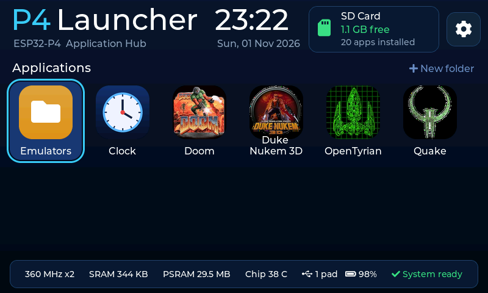
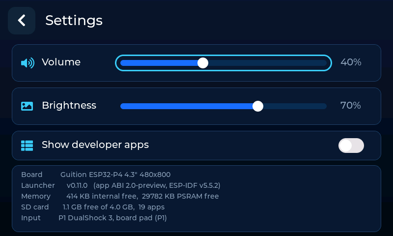
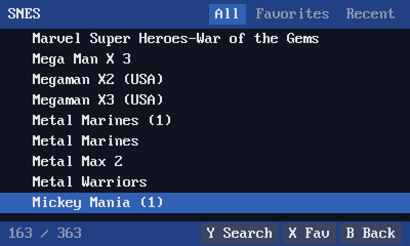
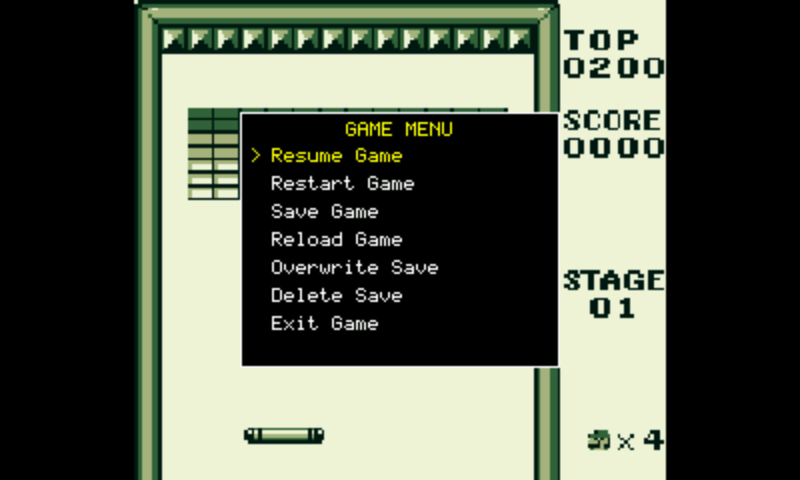
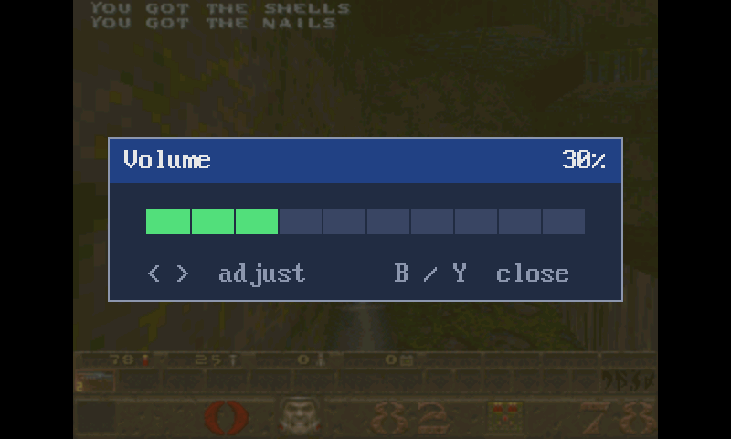
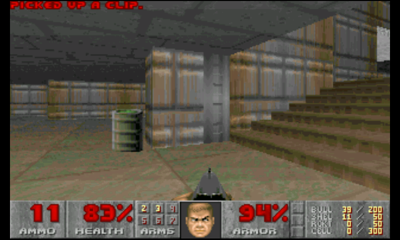
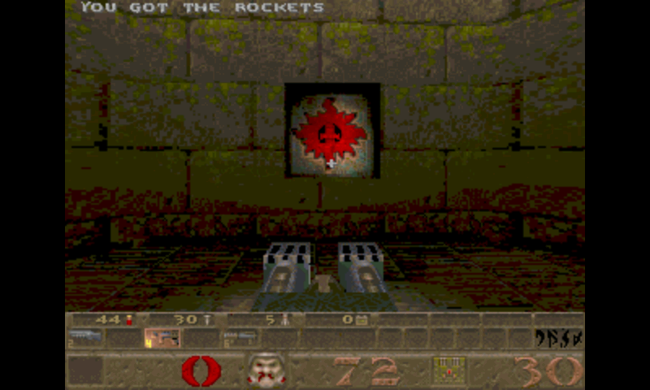
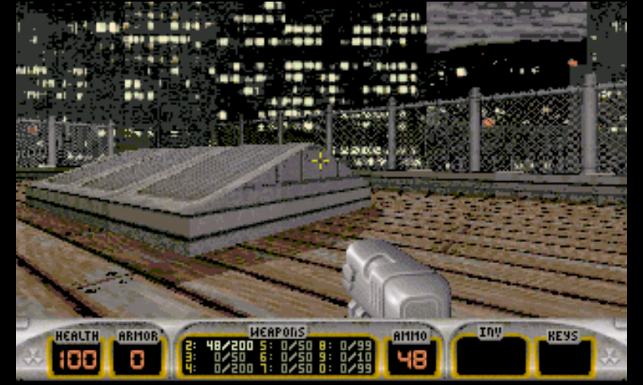
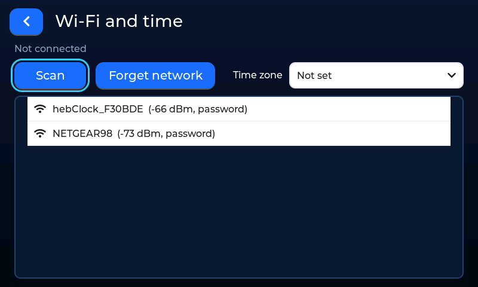

# ESP32-P4 Launcher [](https://discord.gg/nf5tPjMbUY)

**Run applications from an SD card on an ESP32-P4, the way a PC runs a program from a disk.**

The launcher is a permanent firmware that stays in flash. Applications are `.papp` files on the SD card.
Pick one and it is loaded into PSRAM, relocated, linked to the launcher's services and started.
There's no reflashing, no reboot and no flash wear. When it exits, every resource it used is reclaimed.

22 applications run this way today, including NES through Game Boy Advance and Neo Geo emulators, Doom, Quake,
Duke Nukem 3D and OpenTyrian, plus Clock and Files.

The same launcher runs on more than one board, and the same `.papp` files and SD card work on all of them:
today the Guition ESP32-P4 4.3" (800×480), the Guition JC1060P470C 7" (1024×600) and the
M5Stack Tab5 (1280×720).

**Try it without installing anything:** flash your board from the browser with Espressif's ESP Tool page,
copy the `SDcard` folder to a card and get the apps from the Store, see [Getting started](#getting-started).



| Launcher version | App ABI | Toolchain | Boards |
|---|---|---|---|
| 0.29.4 | 2.0-preview | ESP-IDF v5.5.6 | Guition ESP32-P4 4.3" (480×800; chip v1.x, or v3.x with its own image), Guition JC1060P470C 7" (1024×600), M5Stack Tab5 (720×1280), Waveshare ESP32-P4-WIFI6-Touch-LCD-3.5 (320×480, contributed), Waveshare ESP32-P4 dev kit + Raspberry Pi DSI display (800×480, contributed), Elecrow All-in-one Starter Kit for ESP32-P4 (1024×600, not tested yet: [docs/PORT_ELECROW_AIO.md](docs/PORT_ELECROW_AIO.md)) |

> **Status: active development.** The ABI is a preview and may still change. Everything below describes
> what exists in the code today; the plan for what comes next is in [docs/WORKPLAN.md](docs/WORKPLAN.md).

## Contents

- [Screens](#screens)
- [The PAPP concept](#the-papp-concept)
- [What's included](#whats-included)
- [Hardware](#hardware)
- [Getting started](#getting-started)
- [Preparing the SD card](#preparing-the-sd-card)
- [Controls](#controls)
- [Writing your own PAPP](#writing-your-own-papp)
- [Sharing your app](#sharing-your-app)
- [The SDK](#the-sdk)
- [How loading works](#how-loading-works)
- [The `.papp` file format](#the-papp-file-format)
- [Developing without touching the board](#developing-without-touching-the-board)
- [Performance](#performance)
- [Porting to another board](#porting-to-another-board)
- [Repository layout](#repository-layout)
- [Known limitations](#known-limitations)
- [Credits and licensing](#credits-and-licensing)

## Screens

All of these are real screenshots, taken from the running board with `papp_dev.py shot`. The 1024×600
ones come from the 7" board, the 800×480 ones from the 4.3" board.

| | |
|---|---|
|  |  |
| **Home screen:** the Store, folders with their own icons, clock, SD card and settings | **Games folder:** Doom, Duke Nukem 3D, OpenTyrian and Quake |
|  |  |
| **Store:** apps by category, with Get, Update and Installed | **An app's page:** install, update, open or remove it |
|  |  |
| **Settings:** volume, brightness, developer apps, controller mapping, Wi-Fi, update and system information | **Date and time:** on boards with a real-time clock, the home screen clock opens it |
|  |  |
| **HOME** pauses any game under the launcher's menu | **Content browser:** All, Favorites and Recent tabs, with live search. Every emulator gets it from the launcher |
|  |  |
| **Game menu,** the same in every emulator, over the running game | **Volume overlay,** drawn by the launcher for any app |
|  |  |
| **Doom** | **Quake** |
|  |  |
| **Duke Nukem 3D** | **Wi-Fi and time zone,** through the ESP32-C6, with the Wi-Fi file manager |

## The PAPP concept

PAPP stands for **PSRAM App**. The ESP32-P4 can execute code from PSRAM, so a program doesn't have to
live in flash. The launcher treats PSRAM the way a desktop OS treats RAM, and the SD card the way it
treats a disk.

The usual way to host many large programs on an ESP32 is one firmware image per program, flashed into
OTA slots, with a reboot to switch. PAPP replaces that:

| | One firmware per program (OTA) | PAPP |
|---|---|---|
| Where programs live | Flash partitions, fixed in advance | Files on the SD card |
| Adding a program | Reflash, possibly repartition | Copy a file |
| Switching programs | Reboot | Instant return to the launcher |
| Program size limit | Partition size | Free PSRAM |
| Same binary on another board | No, each board needs a build | Yes, that's the goal: only the launcher is ported |
| Cleanup after a program | The reboot does it | The launcher tracks and reclaims everything |

Think of a `.papp` as a **DLL with a `main()`**:

- **It is relocatable.** It has no fixed load address. The loader patches it to wherever memory is available.
- **It imports services by name.** The app declares that it needs, for example, display interface `DISP`.
  The loader checks the launcher provides it and fills in a table of function pointers.
- **It never touches hardware.** Apps include no ESP-IDF headers and know nothing about the board.
  Display, audio, input, files, threads and UI all go through the launcher's interfaces.
- **It can't leave the system broken.** Memory, files, threads and surfaces are tracked per app and
  reclaimed on exit. A hung app can be force-stopped, and a crash is reported with symbols instead of
  becoming a mysterious reboot.

```
┌──────────────────────────────────────────────────────────────┐
│  PAPP apps (.papp on SD)   emulators · games · your code     │
│  app code + SDK runtime (crt0, libc glue, interface stubs)   │
├──────────  ABI: SYS MEM FS DISP AUDI INPT THRD UI NET BLE  ──┤
│  Launcher core (board-agnostic ESP-IDF app in flash)         │
│  loader · App Manager · compositor · audio mixer ·           │
│  input manager · content browser · DevLink · home screen     │
├───────────────  BSP contract: components/bsp/bsp.h  ─────────┤
│  Board package: panel, touch, codec, SD, buttons             │
├──────────────────────────────────────────────────────────────┤
│  ESP-IDF · FreeRTOS · PPA · USB host · I2S · MIPI-DSI        │
└──────────────────────────────────────────────────────────────┘
```

Two rules keep this portable: apps only see the ABI, and the launcher core only sees `bsp.h`.

## What's included

**Launcher**

- LVGL home screen with app icons, folders (with their own icons), clock, SD status and settings, laid out
  for the board's screen size
- More than one board from one source tree: each board is a package under `boards/`, and apps never change
- Compositor: an app draws a surface of any size, and the launcher scales and rotates it with the PPA, tear-free
- Audio engine: up to 8 streams at any rate from 4 to 192 kHz, resampled and mixed
- Input manager: USB HID gamepads and keyboards for up to 4 players, board buttons and touch
- Content browser with folders, Favorites, Recent, search, and per-ROM Run/Resume/Restart/Delete save
- DevLink: a USB protocol to upload, run, log, screenshot, inject input and read crash reports
- Self-update from the SD card or from GitHub Releases (Settings → Update), with automatic rollback if a new
  version doesn't start. Each board only ever installs its own launcher. It also updates the Wi-Fi chip
  (ESP32-C6) firmware to the version the launcher is built for, from the release or from `/sd/update/c6.bin`
- Store: the first tile on the home screen. Apps by category (Emulators, Games, Tools, Productivity, Education,
  Community, Installed), each with its icon, description and version; installs, updates and removes them over
  Wi-Fi (downloads checked with SHA-256), and the tile counts the updates waiting
- Controllers: USB HID pads are read from their own report descriptor, Xbox 360-style (XInput) pads and receivers such as 8BitDo's work too, and any pad can be remapped in Settings
- Wi-Fi and network time through the on-board ESP32-C6; the network is saved on the SD card (`config/wifi.txt`)
- Real-time clock on boards that have one: the time survives power-off, and the home screen clock opens a
  date and time setup
- Battery level in the system bar, on boards that measure it
- Wi-Fi file manager: a web page for the SD card, started from the Wi-Fi screen and protected by a PIN
- Screenshots: Select + Y saves a BMP to `/sd/screenshots`
- Game menu: every emulator has the same launcher-drawn menu (Resume, Save, Load, Restart, Delete save,
  Volume, Exit), and HOME pauses any game for volume, a screenshot or quitting

**Applications** (all built from this repository)

| App | Source | App | Source |
|---|---|---|---|
| NES | nofrendo | Genesis / Mega Drive | gwenesis |
| Game Boy, Game Boy Color | gnuboy | SNES | snes9x (no SuperFX) |
| Master System, Game Gear, ColecoVision | smsplus | Neo Geo | gngeo |
| PC Engine | huexpress | Atari Lynx | handy |
| Atari 2600 | stella | Atari 7800 | prosystem |
| Atari 800 / XL / 5200 | atari800 | ZX Spectrum | spectemu |
| Doom | prboom | Quake | WinQuake |
| Duke Nukem 3D | Chocolate Duke3D | OpenTyrian | OpenTyrian |
| Game Boy Advance | gpSP ([RISC-V JIT](https://github.com/midworld/gpsp)) | | |
| Clock (clock, alarms, stopwatch, timer, world clock) | This project | Files (browse, preview, delete) | This project |

The test apps (`hello`, `gfx_demo`, `audio_test`, `input_test`, `thread_test`, `fast_bench`, `browse_test`,
`libc_test`) are hidden unless you turn on **Settings → Show developer apps**.

## Hardware

Three boards are supported. All run the same apps from the same SD card. Adding a board:
[docs/PORTING_GUIDE.md](docs/PORTING_GUIDE.md).

| Part | Guition ESP32-P4 4.3" | Guition JC1060P470C 7" | M5Stack Tab5 |
|---|---|---|---|
| Board id (`-DLX_BOARD=`) | `guition_p4_43` (default) | `guition_p4_7` | `m5stack_tab5` |
| SoC | ESP32-P4, dual RISC-V at 360 MHz, chip revision v1.x (v3.x: board id `guition_p4_43_v3`) | same | same |
| Memory | 32 MB hex PSRAM at 200 MHz, 16 MB flash | same | same |
| Display | 480×800 ST7701 MIPI-DSI, used in landscape as 800×480 | 1024×600 JD9165 MIPI-DSI, landscape | 720×1280 MIPI-DSI (ILI9881C, ST7123 or ST7121, detected at start), used in landscape as 1280×720 |
| Touch | GT911 capacitive | GT911 capacitive | GT911, or the touch built into the ST7123 / ST7121 panel |
| Radio | ESP32-C6 over SDIO (Wi-Fi; BLE firmware present) | same, newer C6 firmware | ESP32-C6 over SDIO, M5Stack's C6 firmware |
| Audio | ES8311 codec at a fixed 48 kHz | ES8311 codec at 48 kHz, NS4150 speaker amplifier | ES8388 codec at 48 kHz |
| Clock | from the network or the PC after each power-on | RX8025T real-time clock | RX8130 real-time clock |
| Storage | microSD | microSD | microSD |
| Input | USB host for gamepads and keyboards, optional GPIO button pad, battery pin | USB host for gamepads and keyboards | USB host for gamepads and keyboards |

Contributed, tested by their authors: the Waveshare ESP32-P4-WIFI6-Touch-LCD-3.5 (`waveshare_p4_35`), and the
Waveshare ESP32-P4 Module dev kit with a Raspberry Pi Touch Display (V1) or a compatible one, tested with a
Cuqi 5" (`waveshare_p4_rpi_dsi`: 800×480 at about 47 Hz, FT5x06 touch, ES8311, no real-time clock; USB
gamepads on the lower USB-A port only; notes in [docs/PORT_WAVESHARE_P4.md](docs/PORT_WAVESHARE_P4.md)).

## Getting started

To use the launcher you only need to flash it once, from a web browser, and prepare an SD card. Building from
source is optional.

### 1. Flash the launcher from your browser

You need Chrome or Edge on a desktop computer (the page uses Web Serial, which Firefox and Safari don't
have) and a USB cable for the board's USB-Serial-JTAG port.

1. Download your board's full image from the [latest release](https://github.com/giltal/ESP32_P4_Launcher/releases/latest):

   | Board | File |
   |---|---|
   | Guition ESP32-P4 4.3" | `launcher_guition_p4_43_full.bin` |
   | Guition ESP32-P4 4.3" with a v3.x chip (see below) | `launcher_guition_p4_43_v3_full.bin` |
   | Guition JC1060P470C 7" | `launcher_guition_p4_7_full.bin` |
   | M5Stack Tab5 | `launcher_m5stack_tab5_full.bin` |
   | Waveshare ESP32-P4-WIFI6-Touch-LCD-3.5 | `launcher_waveshare_p4_35_full.bin` |

   A full image holds the bootloader, partition table and launcher, so it goes to address 0. The files
   without `_full` are only the launcher, for Settings → Update.
2. Connect the board and open Espressif's **ESP Tool** page: <https://espressif.github.io/esptool-js/>
3. Under **Program**, click **Connect** and pick the board's port in the browser's list
   (on Windows it shows as a USB Serial Device or USB JTAG). The log then shows the chip, ESP32-P4.
   If it can't connect, hold the board's BOOT button, press RESET, release BOOT and try again.
4. In the file table, change **Flash Address** from `0x1000` to **`0x0`** and choose the `_full.bin` file.
   Leave Flash Mode, Frequency and Size as they are.
5. Click **Program** and wait for the log to finish.
6. Press RESET on the board, or unplug and reconnect it. The home screen appears.

Then [prepare an SD card](#preparing-the-sd-card): copy the `SDcard` folder of this repository to an empty
FAT32 or exFAT card (exFAT: launcher 0.29.4 and later), connect to Wi-Fi in Settings and install apps from the Store (step 4 below).

The same in a terminal, if you have esptool:

```bash
esptool.py --chip esp32p4 -p COMx write_flash 0x0 launcher_guition_p4_43_full.bin
```

**Which 4.3" chip do I have?** Newer Guition 4.3" boards carry a rev v3.x ESP32-P4. An image runs on one
chip generation only, so these have their own image. On the ESP Tool page, the log after **Connect**
shows the chip revision, for example "revision v1.0" or "revision v3.2"; `esptool.py --chip esp32p4
-p COMx chip_id` shows it too. If you flashed the wrong one, the screen stays dark: flash the other
file. After the first install, Settings → Update picks the right image by itself.

### 2. Build the launcher yourself (optional)

Install the tools:

- [ESP-IDF v5.5.6](https://docs.espressif.com/projects/esp-idf/en/v5.5.6/esp32p4/get-started/index.html): use this
  version. The releases are built with it, and the downloaded components (Wi-Fi driver, display drivers, LVGL)
  are pinned to the exact versions that go with it. Another ESP-IDF builds with a warning, but is not tested.
- Python with `pyserial` and `pyelftools` (the ESP-IDF Python environment works if you add them)

In PowerShell, load ESP-IDF for the session. `tools/idf_env.ps1` looks in `%USERPROFILE%\esp\v5.5.6\esp-idf`
unless `IDF_PATH` is already set:

```powershell
. .\tools\idf_env.ps1
```

Connect the board's USB-Serial-JTAG port, and use your own COM port below.

```powershell
cd launcher
idf.py -p COM9 build flash                                                    # Guition 4.3" (default board)
idf.py -B build_guition_p4_43_v3 -DLX_BOARD=guition_p4_43_v3 -p COMx build flash  # Guition 4.3" with a v3.x chip
idf.py -B build_guition_p4_7 -DLX_BOARD=guition_p4_7 -p COM10 build flash     # Guition 7"
idf.py -B build_m5stack_tab5 -DLX_BOARD=m5stack_tab5 -p COM15 build flash     # M5Stack Tab5
idf.py -B build_waveshare_p4_rpi_dsi -DLX_BOARD=waveshare_p4_rpi_dsi -p COMxx build flash   # Waveshare + RPi display
cd ..
```

Each board builds in its own folder. The boards use different versions of the ESP32-C6 driver, so when you
switch to the other board, add `reconfigure` once: `idf.py -B <folder> -DLX_BOARD=<id> reconfigure build`.
The 4.3" with a v3.x chip has its own board id, `guition_p4_43_v3` (same board code, built for v3 silicon).

> On Windows, `papp_dev.py` needs the same COM port, so close any serial monitor first. Text logs go to
> UART0. USB-Serial-JTAG belongs to DevLink.

### 3. Build the apps (optional)

Apps only need the `riscv32-esp-elf` toolchain from ESP-IDF, not an ESP-IDF project.

```powershell
python apps/build_all.py                # every app that has a build.py
python apps/build_all.py doom snes      # or just these
```

Output goes to `build/apps/<name>/<name>.papp`, next to the `.elf` and `.map`.

### 4. Install an app

Without building anything: connect to Wi-Fi in Settings, open the **Store** (the first tile on the home
screen) and choose **Install all**. Every published app downloads into its folder (Emulators, Games). Or pick
apps one at a time: open one and choose **Install**. Then add ROMs and game data, see
[Preparing the SD card](#preparing-the-sd-card).

To install an app you built yourself:

```powershell
python tools/papp_dev.py --port COM9 deploy build/apps/doom/doom.papp --timeout 20
```

`deploy` uploads the app and its icon, runs it and streams its log. You can also copy files to the card
directly: anything at `/sd/apps/<dir>/<file>.papp` appears on the home screen. Or, on Wi-Fi, take published
apps from the Store (see [Versions and publishing](#versions-and-publishing)). The Store lists apps copied by
hand too, under Installed, and can remove any of them.

### 5. Update the launcher later

Settings → Update downloads the newest GitHub release for this board, or copy a newly built launcher image
(`launcher.bin` for the 4.3", `launcher_<board id>.bin` for the others) to `/sd/update/launcher.bin` and restart.
The home screen offers the update, and a board refuses another board's image. A new version has to run for 10 seconds to be kept. If it crashes first, the board returns
to the previous version and says so.

> After flashing with `idf.py flash`, the board boots the factory slot again.

The Wi-Fi chip (ESP32-C6) runs its own firmware, and it works best at the version of the launcher's
Wi-Fi library (esp_hosted). The Wi-Fi screen shows both. When they differ, Settings → Update offers
**Update the Wi-Fi chip** after the launcher is up to date: it downloads the release's `c6_<version>.bin`
(or takes `/sd/update/c6.bin` from the card), sends it to the chip in about 15 seconds and restarts the
board. It only installs esp_hosted firmware for an ESP32-C6 at the launcher's version, and if anything
fails the chip keeps its old firmware. The Guition boards support it; the Tab5 and the Waveshare
(esp_hosted 1.4, their makers' firmware) don't. To build the image: `python tools/build_c6_fw.py`.

## Folders

A directory in `/sd/apps` with no `.papp` in it is a folder on the home screen, and each app inside it keeps its
own directory: `/sd/apps/<folder>/<app>/<app>.papp`. There is one level of folders. Deleting a folder returns its
apps to the main page. Other files in a folder aren't shown on the home screen and are never deleted, so the
folder stays until they are removed. `papp_dev.py deploy` finds an app that was moved into a folder.

A folder can have its own icon: put an `icon.png` (best 88x88) in its directory, `/sd/apps/<folder>/icon.png`.
`apps/common/icons/make_folder_icons.py` draws the Games and Emulators icons, `folder_games.png` and `folder_emulators.png`.

## Preparing the SD card

The [`SDcard`](SDcard) folder is a ready start: copy its contents to the root of an empty FAT32 or exFAT card, then on
Wi-Fi open the **Store** and choose **Install all**. It already holds the freely shareable game data: Tyrian 2.1
(freeware), the Doom and Quake shareware episodes and gngeo's data file. It also has the controller database and
an empty folder for each system's ROMs. Its [README](SDcard/README.md) explains each folder.

```
/sd
├── apps/<name>/<name>.papp     applications (the Store puts them here)
├── apps/<name>/icon.png        optional icon (square, best at 88×88, transparency OK)
├── config/gamepads.txt         controller mappings shared by everyone (updated by the Store)
├── config/gamepads_mine.txt    your own mappings (Settings → Map controller)
├── config/wifi.txt             your Wi-Fi network (Settings → Wi-Fi, or write it yourself)
├── roms/<system>/              ROMs and game data (table below)
├── odroid/data/<system>/       emulator saves (created for you)
└── saves/doom/                 Doom saves
```

No ROMs, BIOS files or commercial game data are included. You need to supply your own legally obtained files.

ROMs can stay zipped: `Zelda.zip` in `/sd/roms/nes/` shows up in the NES list, and the
emulator gets the first file inside whose extension it takes. Its saves are named as if the ROM were `Zelda.nes`. A
`.zip` is unpacked into memory when the game starts (stored or deflate, no passwords). Game Boy Advance ROMs are
unpacked once into `/sd/launcher/zipcache/` instead, which keeps only the last one. Neo Geo games are zips of their
own and are read as they are.

| Game | Copy | In the `SDcard` folder |
|---|---|---|
| Doom | one IWAD to `/sd/roms/doom/`: `doom.wad`, `doom2.wad`, `plutonia.wad`, `tnt.wad`, `doom1.wad` or `freedoom.wad` (the first one found, in that order) | `doom1.wad`, the shareware episode. [Freedoom](https://freedoom.github.io/) also works (rename `freedoom1.wad` to `freedoom.wad`) |
| OpenTyrian | the contents of the Tyrian 2.1 folder (`tyrian1.lvl`, `music.mus`, `*.shp`, ...) to `/sd/tyrian/data/` | Tyrian 2.1, [freeware](https://camanis.net/tyrian/tyrian21.zip) and the data OpenTyrian itself uses |
| Quake | `id1/pak0.pak` to `/sd/roms/quake/id1/` | `pak0.pak`, the shareware episode |
| Duke Nukem 3D | `DUKE3D.GRP` to `/sd/roms/duke3d/duke3d.grp` | not included (commercial); tested with the Atomic Edition file |
| Game Boy Advance | the games to `/sd/roms/gba/`; optional BIOS `gba_bios.bin` there (a built-in replacement runs most games) | not included |
| Neo Geo | `neogeo.zip` (BIOS) and the games to `/sd/roms/neogeo/` | `gngeo_data.zip`, the emulator's own data; the BIOS is not included |

Doom's `prboom.wad` is built into the app; you don't need to copy it.

| App | Folder | App | Folder |
|---|---|---|---|
| NES | `/sd/roms/nes` | Atari 2600 | `/sd/roms/a26` |
| Game Boy | `/sd/roms/gb` | Atari 7800 | `/sd/roms/a78` |
| Game Boy Color | `/sd/roms/gbc` | Atari 800 | `/sd/roms/a800` |
| Master System | `/sd/roms/sms` | Atari Lynx | `/sd/roms/lynx` |
| Game Gear | `/sd/roms/gg` | ZX Spectrum | `/sd/roms/spectrum` |
| ColecoVision | `/sd/roms/col` | PC Engine | `/sd/roms/pce` |
| Genesis | `/sd/roms/gen` | SNES | `/sd/roms/snes` |
| Neo Geo | `/sd/roms/neogeo` | Doom | `/sd/roms/doom/doom.wad` |
| Quake | `/sd/roms/quake/id1/pak0.pak` | Duke Nukem 3D | `/sd/roms/duke3d/duke3d.grp` |
| OpenTyrian | `/sd/tyrian/data` | Game Boy Advance | `/sd/roms/gba` |

## Controls

The launcher accepts a USB gamepad, a USB keyboard, touch and the optional board buttons, which merge into
player 1.

| Where | Action |
|---|---|
| Home screen | D-pad moves, A starts, or tap an icon. B leaves a folder. The SD card panel opens Files. On boards with a real-time clock, the clock opens the date and time setup |
| App or folder menu | X or Y (Tab on a keyboard), or hold the icon: move an app, rename or delete a folder |
| New folder | **New folder** at the top right. Type the name by touch or USB keyboard. With only a pad, A accepts the suggested name |
| Browser | A runs, Y searches, X toggles a favorite, B goes back |
| Most emulators | X or a tap on the left screen edge opens the game menu, Y or the right edge opens volume |
| SNES, Genesis, Neo Geo | X and Y are game buttons, so tap the **left** screen edge for the menu and the **right** edge for volume |
| Doom, OpenTyrian | X is the game's own menu, hold X for 3 s to exit |
| Quake, Duke Nukem 3D | Tap the left edge for the menu, the right edge for volume, hold the left edge for 3 s to exit |
| Anywhere | HOME, or holding Select+Start for 1 s, pauses the game under a menu: Resume, Volume, Screenshot, Quit to home. In the ROM browser it quits the app |

Choosing **Exit game** in an emulator returns to its ROM browser. Leaving the browser returns to the home screen.

Every emulator's game menu is drawn by the launcher and offers the same items: Resume game, Save game, Load
saved game and Delete save (when there is a save), Restart game, Volume and Exit game. Volume is the
launcher's volume, the same as in Settings. On the Spectrum, Y opens the on-screen keyboard instead of volume.

### Controller mappings

Most USB pads work without setup. If the buttons of yours come out wrong, map it once in **Settings → Map
controller**. Mappings are text on the card, one line per controller model (USB VID:PID):

```
054C:0268  A=B B=A  # DualShock 3
```

Each `<button the pad reports>=<button it should be>` pair lists a button that differs; `-` ignores one. The
launcher reads `/sd/config/gamepads_mine.txt` (yours, written by Map controller), then `/sd/config/gamepads.txt`
(the shared database). **Share a mapping:** add its line to [`SDcard/config/gamepads.txt`](SDcard/config/gamepads.txt)
in a pull request. The Store downloads the newest database together with the app list, so the next
owner of that pad doesn't need to map it. Mappings made with a launcher before 0.23 (kept in the board's flash)
still work and are copied to your file the first time the pad connects.

The database already covers the Sony DualShock 3 and DualShock 4, the 8BitDo Ultimate 2C Wired and generic
USB NES pads (VID 0079, PID 0011).

### Wi-Fi network

The network joined in **Settings → Wi-Fi** is saved on the card in `/sd/config/wifi.txt`, so it moves with the
card to another board. To set up a board without its screen, write the file yourself:

```
ssid=MyNetwork
password=MyPassword
```

Delete the file, or choose Forget, to forget the network. The password is stored as plain text. A network saved
by a launcher before 0.24 (in the board's flash) is moved to the card at the next start.

## Writing your own PAPP

A complete app, which bounces a square and exits on B:

```c
#include "papp/papp.h"

PAPP_MANIFEST(.id = "demo.bounce", .name = "Bounce", .version = PAPP_APP_VERSION, .main_stack = 16384);

int main(int argc, char **argv)
{
    papp_surface_cfg_t cfg = { .width = 320, .height = 240, .format = PAPP_PIXFMT_RGB565,
                               .scale = PAPP_SCALE_FIT_ASPECT, .buffers = 2 };
    papp_surface_t *s = papp_disp_surface_create(&cfg);
    if (!s) return 1;

    int x = 40, y = 40, dx = 2, dy = 2;
    while (!papp_exit_requested()) {
        papp_gamepad_t pad;
        if (papp_input_gamepad(0, &pad) && (pad.buttons & PAPP_BTN_B)) break;

        int stride;
        uint16_t *px = papp_disp_lock(s, &stride);
        for (int i = 0; i < 240 * stride; i++) px[i] = 0;
        for (int r = 0; r < 24; r++)
            for (int c = 0; c < 24; c++) px[(y + r) * stride + x + c] = PAPP_RGB565(255, 180, 0);
        papp_disp_present(s);           /* one frame on the panel, no tearing */

        x += dx; y += dy;
        if (x <= 0 || x >= 296) dx = -dx;
        if (y <= 0 || y >= 216) dy = -dy;
    }
    papp_log("bye\n");
    return 0;
}
```

Save it as `apps/bounce/main.c`, then build and run it:

```powershell
python papp-sdk/tools/papp_build.py --name bounce --src apps/bounce/main.c
python tools/papp_dev.py --port COM9 deploy build/apps/bounce/bounce.papp --timeout 20
```

The result is a 944-byte image. Notice the app never mentions a screen size or panel rotation: it draws
320×240, and the launcher fits that to the display.

### `papp_build.py` options

| Option | Meaning |
|---|---|
| `--name` | App name, and the output folder under `build/apps/` |
| `--src` | One or more `.c` / `.cpp` files |
| `--inc` | Extra include folders |
| `--libc` | Link newlib: `printf`, `fopen`, `malloc`, math. Stdio works on the SD card, and `malloc` goes through the launcher so it's tracked |
| `--out` | Output path |

An `icon.png` next to the first source file is packaged with the app. Larger apps use a small `build.py`
that calls `papp_build`. See [apps/nes/build.py](apps/nes/build.py), and
[apps/build_all.py](apps/build_all.py) picks up any app folder that has one.

### The manifest

`PAPP_MANIFEST` puts metadata in the file, which the launcher reads before running anything:

| Field | Meaning |
|---|---|
| `.id` | Unique id, such as `"demo.bounce"` |
| `.name` | Name on the home screen |
| `.version` | `PAPP_APP_VERSION`: the `version.txt` next to the app's sources, such as `1.2.0` |
| `.main_stack` | Main stack size in bytes |
| `.flags` | `PAPP_MF_STACK_PSRAM` puts the stack in PSRAM, `PAPP_MF_HIDDEN` marks a developer app |

### Versions and publishing

Each app keeps its version in a `version.txt` next to its first source file (or next to its `build.py`).
`papp_build.py` passes it to the code as `PAPP_APP_VERSION`, and the home screen shows it in the app's menu
(hold the icon, or X). When you change an app, raise its version, rebuild and publish:

```powershell
python apps/build_all.py
python tools/make_apps_release.py --publish     # needs the GitHub CLI, logged in
```

This uploads every app that isn't a developer app, with its icon and `apps.json`, to the repository's `apps`
release (a pre-release, so it never replaces the launcher's own latest release). It publishes only from an
up-to-date checkout: `community/`, `apps/store.json` and the controller list must match `origin/main` with nothing
uncommitted, and no app already in the Store may disappear or go back to an older version (`--force` overrides). The Store on a board then
offers **Update** for each app whose online version is newer than the one on its card, and its tile shows how
many there are. Each app's category and one-line description come from [`apps/store.json`](apps/store.json)
(the release script stops when an app is missing there). An app is
updated where it is, even if it was moved into a folder; a new app goes to the folder named in the catalogue
(emulators to Emulators, games to Games). To try a catalogue from your own server first, build it with
`--base http://<server>/` and put that `apps.json` address in `/sd/update/apps_url.txt`.

### Making hot code fast

Everything runs from PSRAM through the CPU caches by default. For inner loops, tag code and data to load
them into internal SRAM instead. This is limited to 192 KB per app by default
(`CONFIG_LX_APP_FAST_MAX_KB`), and if it doesn't fit it falls back to PSRAM, so it's correct either way.

```c
PAPP_FAST void cpu_step(void) { /* ... */ }
PAPP_FAST_DATA static uint8_t ram[2048] = { 1 };
PAPP_FAST_BSS  static uint16_t line[320];
```

### Rules for well-behaved apps

- Poll `papp_exit_requested()` in your main loop, and in worker threads.
- Join the threads you create. Whatever is left is stopped by the launcher.
- Don't include ESP-IDF headers, and use only the SDK.
- A stack larger than the internal limit lives in PSRAM. That's fine for your code, but the launcher can't
  touch flash from such a stack, so launcher services that write flash must hand that work to an
  internal-stack task.

## Sharing your app

You can share an app you built without sharing its source: send the `.papp` in a pull request. Once it is
merged, it appears in the **Store** under **Community** (and under its category) with your name, and installs into the Community
folder on the home screen (there from launcher 0.25.1 on, empty until you install one). Updates reach users the same way as the project's apps.


**What to send.** One folder per app under [`community/`](community), named like the app in lowercase:

```
community/my-game/
├── my-game.papp       the app, at most 4 MB (larger: see below)
├── icon.png           square PNG, 64 to 256 pixels, 88×88 is best, transparency OK
├── app.json           author, description, category, licence, optional source link
└── screenshot.png     optional
```

```json
{
  "author": "Your name or GitHub user",
  "description": "One line about the app, shown in the Store",
  "category": "games",
  "license": "MIT",
  "source": "https://github.com/you/your-app"
}
```

1. Give the app its own id in `PAPP_MANIFEST` (`yourname.game`). Ids starting with `emu.`, `game.`, `test.`,
   `sys.` or `lx.` belong to the project. Put the version in `version.txt` beside the source.
2. Check the folder: `python tools/community.py`.
3. Open a pull request. Without git: fork the repository on GitHub, open `community/`, choose
   **Add file → Upload files** and drop the folder in. The pull request template has a short checklist.

A check runs on every pull request ([`.github/workflows/community.yml`](.github/workflows/community.yml)). It
reads the app's manifest and fails if:

- the id is taken or reserved, or the app is marked hidden
- a changed app keeps its old version, or goes back to a lower one
- the app needs an interface version the launcher doesn't have
- a file is missing, too big, or doesn't belong in the folder

To update your app, bump `version.txt` and send the new `.papp` the same way. An app over 4 MB stays on
your own release page: leave the `.papp` out and put `"url"`, `"sha256"` and `"size"` in `app.json`. The
launcher checks every download against that SHA-256.

**Before you install or merge one.** A PAPP is native code and runs without a sandbox: an app can do anything
the board can, including deleting files on the card. Without the source, nobody can review what it does. So
the Store names the author and marks community apps as not reviewed, and **Install all** never installs
them; each one is the user's own choice. Merge apps from people you trust.

**Licences.** An app built on GPL code, such as most emulator cores, can't be shared as a binary alone. Its
source has to be published too, so put the link in `source`.

## The SDK

Include only `papp/papp.h`. The full API, with examples, is in
[papp-sdk/include/papp/papp.h](papp-sdk/include/papp/papp.h).

| Interface | Version | What it gives you | Example calls |
|---|---|---|---|
| `SYS` | 3 | Logging, time, local time, UTC time, exit, board id | `papp_log`, `papp_time_us`, `papp_local_time`, `papp_utc_time`, `papp_exit` |
| `MEM` | 1 | Tracked allocation from PSRAM, internal or DMA memory | `papp_alloc`, `papp_free` |
| `FS` | 1 | Files, also reachable through stdio with `--libc` | `papp_fs()` |
| `DISP` | 3 | Surfaces, scaling, tear-free present, zero-copy present, touch | `papp_disp_surface_create`, `papp_disp_present`, `papp_disp_present_ext` |
| `AUDI` | 1 | Push audio streams at any rate, mixed by the launcher | `papp_audio_open`, `papp_audio_write` |
| `INPT` | 2 | Gamepads, keyboard, events, analog inputs | `papp_input_gamepad`, `papp_input_poll_event` |
| `THRD` | 1 | Up to 16 threads, plus mutexes, semaphores and queues | `papp_thread_create`, `papp_queue_send` |
| `UI` | 3 | Content browser, message box, menu, volume overlay | `papp_ui_pick_file`, `papp_ui_menu`, `papp_ui_volume` |

Interfaces are versioned independently. New functions are only ever appended and the version bumped, and a
breaking change gets a new id, so older apps keep working. Interfaces can be required or optional: when an
optional one is missing the app still runs and can check for it, while a missing required one stops the app
from loading.

### Porting existing code

Two compatibility layers let large existing code build unchanged:

- [apps/common/odroid](apps/common/odroid) re-implements the `odroid_*` API, a FreeRTOS subset and ESP-IDF
  shims on the SDK. This is how the emulator cores from RetroESP32-P4 run without edits.
- [apps/common/v1compat](apps/common/v1compat) implements the older PAPP v1 service table on the SDK, which
  is how Doom, Quake, Duke Nukem 3D and OpenTyrian run with their original glue code.

## How loading works

1. **Validate:** check the magic number, format version and CRCs, then read the manifest.
2. **Check compatibility:** every required interface must exist at the required version.
3. **Allocate:** PSRAM for the main image, and internal SRAM for any FAST region.
4. **Load:** read the images from the SD card and zero `.bss`.
5. **Relocate:** patch absolute addresses and any references that cross between PSRAM and SRAM.
6. **Link:** write the interface pointers into the app's import table.
7. **Make executable:** write back the data cache, map the PSRAM a second time as executable, and
   invalidate the instruction cache.
8. **Run:** create the app's task, run constructors and call `main()`.
9. **Tear down:** on exit, stop remaining threads and reclaim memory, files and surfaces.

Quake, for example, loads in about 70 ms (read 50 ms, relocate 20 ms for 2,332 relocations).

An app can also return `PAPP_EXIT_RELAUNCH` to be restarted fresh with no arguments. That's how an emulator's
**Exit game** returns to its ROM browser.

Forced stop works in stages: the app is asked to exit, then its threads are suspended at a moment when none
is inside a launcher service, and resources are reclaimed. If a crash happens, the core dump is kept in flash
and the home screen tells you which app crashed.

## The `.papp` file format

```
┌──────────────────────┐
│ header (64 bytes)    │  magic "PAP2", sizes, offsets, CRC32s
├──────────────────────┤
│ SLOW image           │  code + data, loaded to PSRAM
├──────────────────────┤
│ FAST image (optional)│  PAPP_FAST code + data, loaded to internal SRAM
├──────────────────────┤
│ relocation records   │  8 bytes each
└──────────────────────┘
```

The import table and manifest live inside the SLOW image. `.bss` isn't stored, only its size. The header and
relocation types are defined in
[components/papp_abi/include/papp_abi.h](components/papp_abi/include/papp_abi.h), the single source of truth
shared by the launcher and apps.

The build pipeline is:

```
.c/.cpp ──gcc──▶ .o ──ld (papp.ld, -q keeps relocations)──▶ .elf ──papp_pack.py──▶ .papp
```

`papp_pack.py` runs on the PC. It reads the ELF, converts its relocations to the compact on-device form, and
fails the build with a message if it finds something it can't express. That keeps the on-device loader small
and fast. `tests/host/test_reloc.py` checks that a relocated image matches a real link at other addresses
(it needs `pyelftools`).

## Developing without touching the board

`tools/papp_dev.py` talks to the launcher over USB, so you can run the whole edit-build-test loop from the PC.

```powershell
python tools/papp_dev.py --port COM9 deploy build/apps/hello/hello.papp --timeout 20 -- arg1
python tools/papp_dev.py --port COM9 shot screen.png                     # save a screenshot
python tools/papp_dev.py --port COM9 crash --elf build/apps/hello/hello.elf   # symbolized crash report
python tools/papp_dev.py --port COM9 input pad A+START --hold 200        # press buttons
python tools/papp_dev.py --port COM9 input text "hi"                     # type
```

| Group | Commands |
|---|---|
| Files | `ls` `stat` `put` `get` `rm` `mkdir` `mv` |
| Running | `deploy` `run` `stop` `status` `log` |
| Device | `info` `reboot` `shot` |
| Crashes | `crash` `crash-clear` |
| Input | `input state [--watch 10]`, `input pad`, `input key`, `input text` |

`deploy` returns the app's exit code (124 means timeout), and can inject input at set times:

```powershell
python tools/papp_dev.py --port COM9 deploy app.papp --inject 500:pad:A --inject 900:text:hi
```

Touch can't be injected, so touch paths still need a person.

## Performance

Measured on the reference board with launcher 0.11.0, and Neo Geo with 0.12.0. **FPS** means finished frames reaching the display per
second of real time. Quake's figure comes from its own `timedemo demo1`.

| App | Frames on screen | Audio underruns | Notes |
|---|---|---|---|
| NES-era systems (GB, GBC, SMS, GG, ColecoVision, PC Engine, Lynx, Atari 800) | ~60 fps | 0–3 in 20 s | Full speed |
| Atari 2600 | 60 fps | 2 in 20 s | Full speed |
| ZX Spectrum | ~50 fps | 0 | Full speed (PAL) |
| Atari 7800 | ~30 fps | 2 in 20 s | Draws every second frame, as the original core does |
| Genesis | ~54 fps | 6 in 20 s | Emulates at 60, skips some frames when drawing |
| SNES | ~35 fps | 8 in 20 s | Emulates at 60, skips frames when drawing |
| Neo Geo | ~32 fps | not measured | Metal Slug, about 11 s to load |
| Game Boy Advance | 37–60 fps (game at 60) | low | Launcher 0.29.1, 7": Golden Sun, Super Mario World, Kirby 60; Zelda Minish Cap 53; Castlevania Aria 47; Mario Kart 37 drawn, skipping frames to keep the game and sound at full speed. Needs 0.29.1 for the JIT |
| Duke Nukem 3D | ~41 fps in E1L1, 52 in menus | low | Software renderer |
| Doom | ~33 fps | 0 | Software renderer |
| Quake | ~20 fps | 1 | `timedemo demo1`, software renderer |

Each present costs about 5 ms of PPA time (7 ms for GBA on the 7"); since launcher 0.29.1 the PPA works while the app runs its next frame.

SD reads reach about 11.5 MB/s through the launcher's file service. Every open file gets a 16 KB DMA-aligned
buffer, because reads into an unaligned buffer fall back to one sector at a time, at about 1.5 MB/s.

## Porting to another board

The launcher core never includes board headers, so a port is one folder:

```
boards/<id>/board/           your implementation of components/bsp/include/bsp.h
boards/<id>/sdkconfig.board  PSRAM, flash, CPU and chip revision settings
```

The contract in [components/bsp/include/bsp.h](components/bsp/include/bsp.h) covers board information and
capabilities, SD card, display (at least two framebuffers), touch, audio at one fixed rate, buttons, battery and
real-time clock.
Declare your panel's rotation and the compositor and touch code adapt. Copy
[boards/guition_p4_43](boards/guition_p4_43) as a start, then build with `idf.py -DLX_BOARD=<id> build`.

Existing `.papp` files run unchanged: the Guition 7" and the M5Stack Tab5 run the same SD card with no app
rebuilt. [docs/PORTING_GUIDE.md](docs/PORTING_GUIDE.md) is the checklist from that port.

## Repository layout

```
launcher/              ESP-IDF project: main.c + home.c (LVGL home screen)
boards/<id>/           board packages: guition_p4_43 (4.3"), guition_p4_43_v3 (the 4.3" with a v3.x chip),
                       guition_p4_7 (7"), m5stack_tab5,
                       waveshare_p4_35 (Waveshare 3.5" SPI, needs ESP-IDF >= 5.5.5),
                       waveshare_p4_rpi_dsi (Waveshare dev kit + RPi DSI display)
components/
  bsp/                 BSP contract (bsp.h)
  papp_abi/            .papp format and interface definitions
  lx_loader/           App Manager: loader, relocation, imports, services, teardown
  lx_comp/             compositor (surfaces → PPA → panel)
  lx_audio/            audio engine
  lx_input/            input manager, controller mappings (lx_padmap.c)
  lx_ui/               content browser, menus, overlays
  lx_gfx/              software drawing and font for launcher screens
  lx_devlink/          DevLink protocol
  lx_common/           CRC32, launcher version
  lx_net/              Wi-Fi, NTP and time zone through the ESP32-C6
  lx_update/           self-update from the SD card and GitHub Releases
  lx_web/              Wi-Fi file manager
papp-sdk/
  include/papp/        public API
  runtime/             crt0, libc glue, interface stubs
  ld/                  linker script
  tools/               papp_build.py, papp_pack.py
apps/                  emulators, games and test apps
  common/odroid/       RetroESP32 compatibility layer
  common/v1compat/     PAPP v1 compatibility layer
  common/icons/        emulator and folder icons
tools/papp_dev.py      DevLink host tool
tools/build_c6_fw.py   Wi-Fi chip (ESP32-C6) firmware matching the launcher's esp_hosted
tools/make_release.py  release files for Settings → Update, every board
tools/make_apps_release.py  app catalogue, community apps and controller database for the Store
tools/community.py     checks the community apps (the pull request check runs it)
community/             apps shared without their source, one folder each
SDcard/                starter card: shareable game data, controller database, ROM folders
tests/host/            relocation test
tests/board/smoke.py   board regression run
docs/                  design, plan, test checklist, porting guide
```

Further reading:

- [docs/ARCHITECTURE.md](docs/ARCHITECTURE.md): the design and its reasoning. Parts of it are the original
  proposal, so the code and `papp_abi.h` win where they differ.
- [docs/WORKPLAN.md](docs/WORKPLAN.md): status and roadmap
- [docs/TESTING.md](docs/TESTING.md): test checklist and results per app
- [docs/PORTING_GUIDE.md](docs/PORTING_GUIDE.md): adding a board

## Known limitations

- **One app at a time,** with one display surface.
- **No memory protection between app and launcher.** Internal RAM is both writable and executable, because the
  FAST region needs it. Teardown protects against leaks, not against a malicious app.
- **The ABI is a preview,** and may change before 1.0.
- **PPA scaling steps are 1/16,** so stretched output can leave a few pixels unused.
- **Xbox One pads (GIP protocol) aren't supported;** Xbox 360-style XInput pads are. Non-Sony HID pads are only tested with sample descriptors.
- **Battery percentage isn't calibrated** against a real discharge curve.
- **Not done yet:** mouse, keyboard layouts, rumble, BLE controllers and the pull audio model.
- **SNES:** no SuperFX games.
- **Emulator menus:** the 2600 and Lynx draw theirs on a black background.
- **Under observation:** the USB HID task aborted once during testing and hasn't recurred. The cause isn't known yet.

## Credits and licensing

This project grew out of [RetroESP32-P4](https://github.com/giltal/RetroESP32-P4), the reference for its drivers
and ports. The launcher UI uses [LVGL](https://lvgl.io). The Clock's text is drawn with
[Montserrat](https://github.com/JulietaUla/Montserrat) (SIL Open Font License 1.1), rendered by `apps/clock/make_font.py`.

This project's original code (launcher, SDK, tools, compatibility layers and board support) is released under
the [MIT License](LICENSE).

The emulators and game engines under `apps/` are the work of their own authors and **are not covered by the MIT
license**. They keep their own licenses, which differ from one another:

| Code | License |
|---|---|
| Most cores and engines, such as nofrendo, prboom, stella, atari800 and WinQuake | GPL or LGPL, see the notices in each source folder |
| gwenesis (Genesis) | AGPLv3, see `apps/genesis/core/LICENSE` |
| snes9x (SNES) | Its own non-commercial license, see `apps/snes/core/snes9x/LICENSE` |
| MAME-derived Z80 code (`apps/sms/core/cpu/z80.c`, `apps/neogeo/core/mamez80/z80.c`) | Non-commercial terms in the file header |
| Chocolate Duke3D | See the `LICENSE` files under `apps/duke3d/duke3d/` |

A `.papp` built with one of these components has to follow that component's license too, so check it before
redistributing a built app. Some of these terms rule out commercial use. Your own apps built on the SDK are
not affected by them.

Game names, logos and screenshots belong to their respective owners, and no commercial game data is included.
