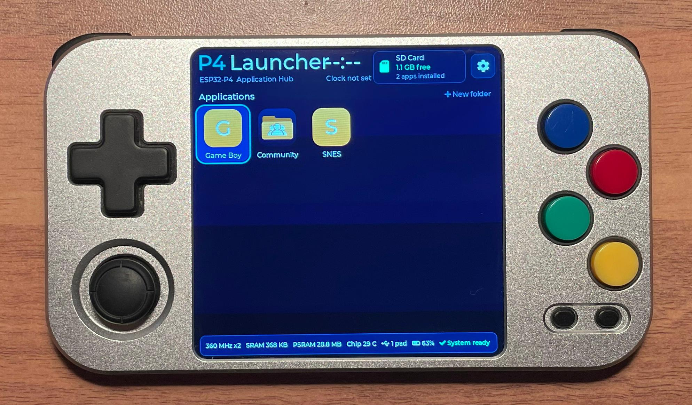

# Pico Held 2



Pico Held 2 is an open-source DIY ESP32-P4 handheld with a 720×720 MIPI-DSI display, an I2S DAC with a built-in amplifier, an SD card connected over SDMMC, GPIO buttons, and battery-level sensing.

You can find all the details [here](https://github.com/fcipaq/picoheld2).

It has a d-pad as well as an analog stick and features 4 buttons (ABXY) plus L/R shoulder buttons and START/SELECT.

The device does **not** include touch input, an RTC, or a Wi-Fi radio.

## Building

To build and flash:

```sh
cd launcher
idf.py -B build_picoheld2 -DLX_BOARD=picoheld2 -p COM10 build flash
```

## Features not yet exposed in `bsp.h`

The following hardware features are present but are not yet exposed through `bsp.h`:

- Analog stick: GPIO16 and GPIO17
- Proper support for the START key since it needs ADC readings
- VEXT sense: GPIO18 (detects external power source)
- Charger status: GPIO53
- SD card detect: GPIO47
